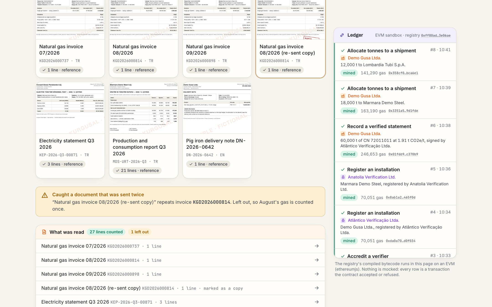
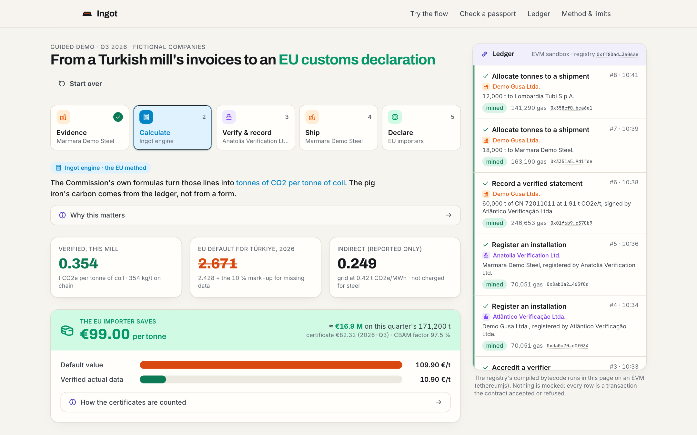
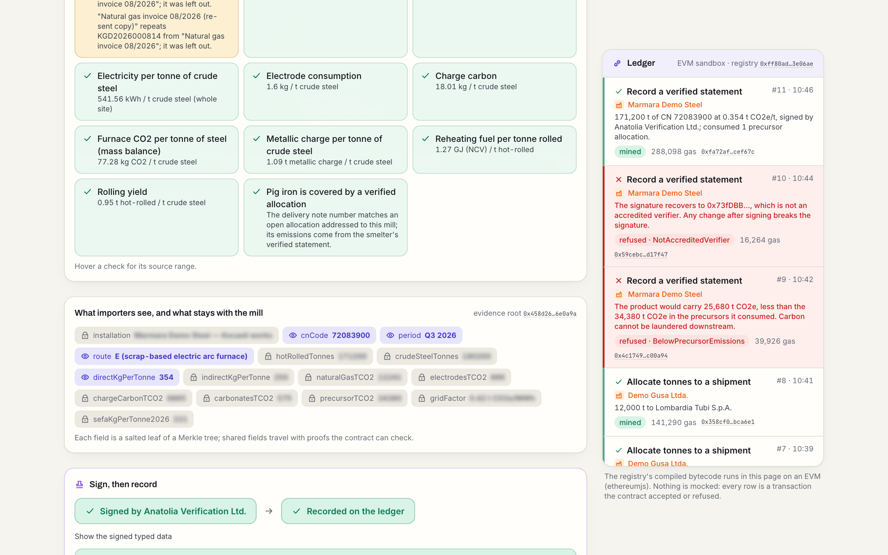
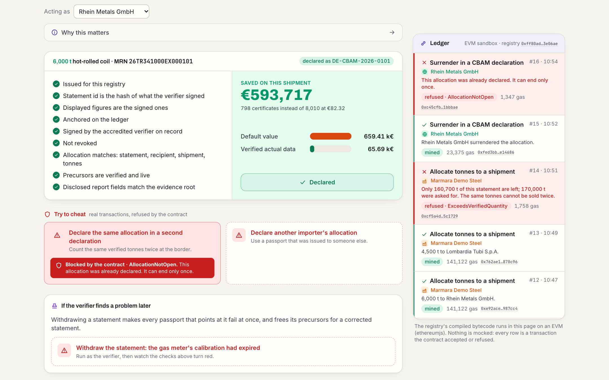

# Ingot · every tonne carries its carbon, once

[](https://github.com/ZNLong2203/Ingot/actions/workflows/ci.yml)

Since 1 January 2026 EU importers pay for the carbon embedded in steel, aluminium, cement and fertiliser (the Carbon Border Adjustment Mechanism, CBAM). Without verified data from the foreign mill they pay on default values that the EU marks up on purpose. **Ingot** turns a mill's invoices into a verified CBAM emissions statement and then lets each verified tonne travel, through precursors, shipments and customs, to **exactly one** declaration. AI reads the evidence; a deterministic engine applies the EU method; an accredited verifier signs; a smart contract keeps the count.

**IEEE ClimateChain Global Hackathon 2026 · Track: Carbon Markets & Emissions Transparency** (with Sustainable Supply Chains alongside).

**Live demo: [ingot-six-blush.vercel.app](https://ingot-six-blush.vercel.app)** · **Video (3 min): _link added at submission_** · Try it in five minutes: open *Try the flow*, press *Read all 7 documents*, and follow the steps; the buttons marked *Try to cheat* send real transactions that the contract refuses.



| The EU method, in code | The verifier signs; cheats are refused | The importer checks and declares |
|---|---|---|
|  |  |  |

## The problem, in numbers

- **€10.8 bn** of CBAM-covered goods went from Türkiye to the EU in 2025, second only to China; iron and steel were €7.2 bn of it ([Eurostat Comext via cbamguide.com](https://cbamguide.com/countries/turkey/)).
- **About 70 %** of Turkish steel is made in scrap-based electric arc furnaces, yet the EU default for Turkish hot-rolled coil, **2.428 t CO2e/t** (2.671 with the 2026 mark-up), assumes the blast-furnace route ([Reg. (EU) 2025/2621](https://taxation-customs.ec.europa.eu/document/download/1c05d211-80cb-4aaa-8ef0-e08005a95d7e_en?filename=DV%20correcting%20act_final%20update_06.08.xlsx); [Turkish exporters' association, April 2026](https://eurometal.net/cbam-warning-from-the-turkish-iron-and-steel-sector-default-emission-values-do-not-align-with-production-realities/)).
- Actual data replaces the default only with a report from an EU-accredited verifier. Turkish-accredited verifiers are not recognised yet, and the first EU-accredited ones arrived in autumn 2026 ([TOBB summit, Jan 2026](https://www.yeniakit.com.tr/haber/istanbuldaki-skdm-zirvesinde-kobi-mesaji-1977909.html); [GMK](https://gmk.center/en/posts/the-european-cbam-how-the-verification-of-reports-will-work/)).
- Analysts already report verified figures that cover exports only, omitted precursors and mass-balance errors; one verifier said "zero foreign exporters would pass a CBAM verification today" ([Eurometal, April 2026](https://eurometal.net/eu-steel-imports-ex-asia-risk-failed-cbam-verifications/)).

For the demo's mill, verified data means **0.354 t CO2e/t instead of 2.671**, and the EU importer surrenders **0.132 certificates per tonne instead of 1.335**: about **€99 less per tonne** at the Q3 2026 certificate price of €82.32. That gap is what makes verification worth paying for, and what makes every tonne of CO2 the mill avoids worth money to its buyers.

## What Ingot does

| Step | Who | What happens |
|---|---|---|
| 1 · Evidence | Mill | Claude reads Turkish gas invoices, the electricity statement, the production report and the pig iron delivery note. Every number comes back with the verbatim text it was read from. A re-sent invoice (same number, *KOPYA* stamp) is caught and left out. |
| 2 · Calculate | Engine | The definitive-period method (Reg. (EU) 2025/2547): a carbon mass balance for the furnace, combustion for the reheating furnace, crude steel as the internal precursor, and the pig iron's embedded emissions **read from the smelter's verified statement on the ledger**, not typed in. Then the CBAM obligation with the column A benchmarks, the 2026 CBAM factor and the published certificate price, against the marked-up default. |
| 3 · Verify & record | Verifier | Plausibility checks against the EU BAT reference documents, a Merkle root of the salted report fields, an **EIP-712 signature**, and the statement recorded on chain. The pig iron allocation it used is consumed. |
| 4 · Ship | Mill | Each shipment takes tonnes from the statement and carries a passport: a W3C-shaped credential with the verifier's signature, the ledger anchor and the shared fields with their proofs. |
| 5 · Declare | Importer | The passport is checked against the ledger (signature, statement, allocation, precursors, disclosures) and surrendered in one CBAM declaration. |

## Four doors the contract keeps shut

[`contracts/CbamPassportRegistry.sol`](contracts/CbamPassportRegistry.sol) enforces what no single company's software can: one global count of verified tonnes across every buyer, trader and tier.

1. **A tonne is verified once.** Statements for one installation and CN code cannot overlap in time (`PeriodOverlaps`).
2. **A tonne is sold once.** Allocations never exceed the verified quantity (`ExceedsVerifiedQuantity`); one customs reference carries one allocation (`ShipmentAlreadyAllocated`).
3. **A tonne ends once.** Each allocation is declared at the border or consumed by a downstream statement, never both, never twice (`AllocationNotOpen`).
4. **Carbon cannot be laundered.** A downstream statement must carry the precursor emissions the contract **recomputes** from the upstream statements (`PrecursorEmissionsMismatch`), and its total may not fall below them (`BelowPrecursorEmissions`). Even a bribed verifier cannot make a re-rolled coil cleaner than the pig iron inside it.

Mistakes can be corrected: withdrawing a statement reopens its period (and any withdrawn ones before it), returns the precursors it consumed, and frees its customs references for the corrected statement.

Only commitments go on chain: the full report is a Merkle tree of salted fields, so a single field can be proven (`verifyDisclosure`) without revealing the rest. See [docs/architecture.md](docs/architecture.md).

## Why a ledger, and not another CBAM SaaS

The EU's own CBAM Registry already lets operators upload data once and share a summary with declarants. Ingot complements it rather than competing: a registry of reports does not, on its own, stop the same verified tonnes being split between two importers who use different systems, or a downstream mill passing on cleaner figures than the precursors it bought. Those are conservation rules across organisations, which is what a shared ledger is for. The verifier stays in charge of the truth of the evidence; the contract makes sure that truth is counted once.

## Climate impact

CBAM cuts emissions only if a producer's real intensity reaches the price its buyers pay. On default values a Turkish mill that switches to cleaner charge carbon or a better reheating furnace saves its customers nothing. With a verified, portable statement every 0.1 t CO2e/t it cuts is worth about €8 per tonne to the EU buyer in 2026, rising to the full carbon price as free allocation ends in 2034. The assessment, its assumptions and low/mid/high projections are in [docs/impact.md](docs/impact.md).

## AI, and where it stops

Claude Opus 5.5 reads documents into schema-checked lines (`lib/ai`), each with its source text. It does no arithmetic and makes no judgement: the engine calculates, the checks flag outliers against cited ranges, and the verifier signs only what they have checked. Uploaded files go to the model and are not stored; the route caps size and type and rate-limits by address. Without an API key the demo uses the documents' reference readings and says so.

## Security and data integrity

Signatures are EIP-712 with a domain bound to one chain and contract, and expire; verifiers are accredited, suspendable and time-limited; every state change is a custom error away from refusal. The threat model (forged evidence, collusion, replay, front-running, key loss, privacy on a public chain) and what remains outside the contract's reach are in [docs/security.md](docs/security.md).

## Run it

```bash
npm install
npm run dev                  # http://localhost:3000, the EVM runs in the page
npm test                     # 24 unit tests: engine, disclosure proofs, sandbox EVM, the whole demo flow
npm run contracts:test       # 29 contract tests (Hardhat 3, node:test, viem)
npm run contracts:build      # compile and export the ABI and bytecode to lib/chain
node e2e/walkthrough.ts      # click through the demo in Chrome (BASE_URL, CHROME_PATH)
```

Optional: put `ANTHROPIC_API_KEY` in `.env.local` to have Claude read the documents (see [.env.example](.env.example)). To deploy the same contract to a public testnet, see [docs/deploy.md](docs/deploy.md).

## Repository

| Path | What |
|---|---|
| `contracts/` | `CbamPassportRegistry.sol` and its tests |
| `lib/cbam/` | Factors with sources, the calculation, the CBAM obligation, plausibility checks |
| `lib/chain/` | The in-page EVM sandbox, EIP-712 types, demo actors, the exported ABI |
| `lib/crypto/` | Salted Merkle commitments and selective disclosure |
| `lib/ai/` | The extraction schema and the Claude call |
| `lib/demo/`, `components/` | The guided demo, ledger and passport pages |
| `lib/samples/`, `public/samples/` | The fictional mill's evidence and the generator for its PDFs |
| `docs/` | Architecture, security, impact, adoption, problem statement, testing |

## Limits

The companies, documents and quantities are fictional, chosen inside the EU BAT ranges. The demo runs the real contract on an EVM in the browser; a production network would be a permissioned EVM run by chambers of industry and verifiers. Ingot does not replace the verifier, the site visit or the EU Registry. Stated assumptions (the reading of the benchmark route indicators, the floor at zero, the carbon-price deduction) are marked in the code and on the [method page](app/method/page.tsx).

## Built with

Solidity 0.8.34 and OpenZeppelin 5.6, Hardhat 3 with viem, the ethereumjs EVM in the browser, Next.js 16, React 19, Tailwind 4, zod, the Anthropic SDK with Claude Opus 5.5, Vitest and Playwright. The project was built with the help of Claude Code.

MIT licence.
