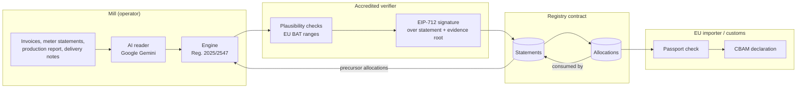

# Architecture

Ingot has four parts: an AI reader that turns evidence into activity data, a deterministic engine that applies the EU method, a registry contract that keeps one count of verified tonnes, and a passport that carries a shipment's data to the importer.

## Data flow

1. **Evidence → activity lines.** `POST /api/extract` sends one PDF or image to Gemini with a strict response schema, then validates the answer with zod (`lib/ai/schema.ts`). Each line names a source stream, a month, a quantity, a unit and the verbatim text it was read from. The model is told never to estimate. Duplicates are resolved by document number, preferring the copy not stamped as a re-send (`lib/demo/derive.ts`).
2. **Activity lines → specific embedded emissions.** `lib/cbam/calculate.ts` models two production processes. The EAF is a carbon mass balance (scrap, pig iron, electrodes, charge carbon in; crude steel out) plus raw carbonates; the reheating furnace is combustion (Sm3 × gross calorific value × 0.9 × 56.1 t CO2/TJ). Crude steel is the internal precursor of the coil. Purchased precursors are not typed in: `findPrecursors` reads open allocations addressed to the mill whose shipment reference equals a delivery note number, and takes their embedded emissions from the upstream statement.
3. **Report → commitment.** The report's fields are committed to a Merkle tree of salted leaves (`lib/crypto/disclosure.ts`; leaves `keccak256(keccak256(abi.encode(salt, key, value)))`, sorted pairs as in OpenZeppelin `MerkleProof`). Salts derive from a secret seed held by the operator.
4. **Signature → statement.** The verifier signs an EIP-712 `Attestation` (installation, CN code, period, quantity, direct and indirect kg CO2e per tonne, carbon price paid, evidence root, hash of the precursor allocation ids, the precursors' embedded emissions, deadline). The operator submits it with the precursor ids. The statement id is the EIP-712 digest, so the passport can prove its fields hash to the id on chain.
5. **Statement → allocations → declarations.** The operator allocates tonnes to a recipient per shipment. The recipient either declares the allocation (EU importer) or consumes it as a precursor in its own statement (downstream mill). Either way it ends once.

## The contract

`contracts/CbamPassportRegistry.sol`, Solidity 0.8.34, OpenZeppelin `EIP712`, `ECDSA`, `MerkleProof`.

| Function | Caller | Checks |
|---|---|---|
| `accreditVerifier`, `suspendVerifier` | authority | — |
| `registerInstallation` | accredited verifier | installation id unused |
| `submitStatement(a, sig, inputs)` | the installation's operator | operator; deadline; period valid and not overlapping; not submitted before; signer accredited; inputs hash matches; each input addressed to the caller, open, upstream not revoked; precursor emissions equal the recomputed sum; total ≥ precursors |
| `allocate(statement, recipient, kg, shipmentRef)` | operator | not revoked; quantity available; shipment reference unused |
| `declare(allocation, ref)` | recipient | open; statement not revoked |
| `revokeStatement(statement, reason)` | signing verifier or authority | not already revoked; reopens the period if it was the latest |
| `verifyDisclosure(statement, leaf, proof)` | anyone (view) | Merkle proof against the evidence root |

State per statement is two storage slots of packed integers plus three words; allocations are four words. Gas measured in the sandbox: recording a statement with one precursor ≈ 288k, an allocation ≈ 141k, a declaration ≈ 23k. Refusals cost 1–40k.

Precursor arithmetic is integer-exact: `floor(Σ quantityKg × kgPerTonne / 1000)`, computed the same way in `lib/chain/eip712.ts`.

## The passport

A shipment's passport (`lib/passport.ts`) is shaped as a W3C Verifiable Credential (`@context` v2, type `CbamEmbeddedEmissionsPassport`), with:

- `credentialSubject`: installation, CN code, period, specific embedded emissions, the allocation (id, tonnes, recipient, customs reference) and the disclosed report fields with their proofs;
- `proof`: `EthereumEip712Signature2021`, with the typed data and the verifier's signature (`did:pkh` verification method), plus a post-quantum co-signature: ML-DSA-65 (FIPS 204) over the statement id, with the public key whose keccak256 the registry stores for that verifier (`pqKeyHash`);
- `anchor`: chain id, registry address and statement id.

`checkPassport` validates it without trusting the sender: domain matches the registry; the typed data hashes to the statement id; the signature recovers to the statement's verifier, still accredited; the statement exists and is live; the allocation matches statement, recipient and tonnes; every consumed precursor's statement is live; every disclosed field verifies against the evidence root.

## Where it runs

- **In the browser.** The demo deploys the compiled bytecode to an ethereumjs EVM inside the page (`lib/chain/sandbox.ts`) and replays a journal from `localStorage`, so every visitor gets a private, deterministic chain with real execution, real signatures and real reverts, and no wallet.
- **On a public testnet.** The same bytecode runs on Ethereum Sepolia at [`0x81700eed…fd95473`](https://eth-sepolia.blockscout.com/address/0x81700eedd80142d65859616101e521729fd95473), with its source verified (exact match on Sourcify). `scripts/deploy-testnet.ts` deployed it with viem and replayed the demo world there; `/verify` checks a passport anchored there by reading the registry through a public RPC node (`lib/chain/public.ts`), with the same `checkPassport` as the sandbox (see [deploy.md](deploy.md)).
- **In production.** A permissioned EVM network (for example Hyperledger Besu) operated by chambers of industry, accreditation bodies and verifiers keeps tonnages confidential to members while preserving the same rules and the same passports.

## Stack

Next.js 16 (App Router), React 19, Tailwind 4, TypeScript, viem, `@ethereumjs/evm`, Hardhat 3, OpenZeppelin 5.6, zod, `@google/genai`, Vitest, Playwright.
